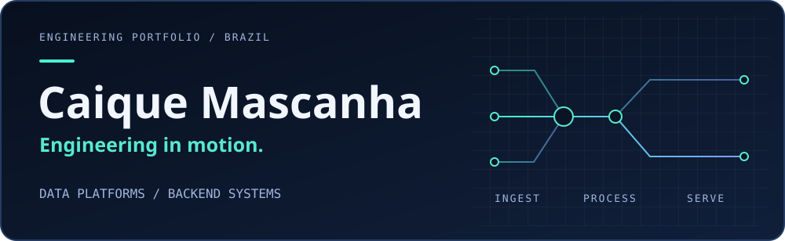

**Idioma / Language:** [EN](#english) · [PT-BR](#pt-br)

## English

### From raw events to usable software

I'm **Caique Mascanha**, a Senior Data Engineer and software developer based in Brazil. I build data pipelines and backend services, with a particular interest in what happens between the first event and the application that uses it.

**My engineering toolkit**

- **Data platforms:** Python, PySpark, Databricks, Delta Lake and SQL
- **Event-driven systems:** Apache Kafka, Debezium and Azure Event Hubs
- **Application development:** Java, Spring Boot, FastAPI and React
- **Infrastructure:** Azure, Docker, PostgreSQL and SQL Server

> **One question that guides my work:** what happens when an event arrives twice, out of order, or not at all?

[Connect on LinkedIn](https://www.linkedin.com/in/caiquemascanha/) · [Ler em português](#pt-br)

---

## PT-BR

### De eventos brutos a software útil

Sou **Caique Mascanha**, engenheiro de dados sênior e desenvolvedor de software no Brasil. Construo pipelines de dados e serviços de backend. O que mais me interessa é entender o que acontece entre o primeiro evento e a aplicação que o usa.

**Tecnologias com que trabalho**

- **Plataformas de dados:** Python, PySpark, Databricks, Delta Lake e SQL
- **Sistemas orientados a eventos:** Apache Kafka, Debezium e Azure Event Hubs
- **Desenvolvimento de aplicações:** Java, Spring Boot, FastAPI e React
- **Infraestrutura:** Azure, Docker, PostgreSQL e SQL Server

> **Uma pergunta que guia meu trabalho:** o que acontece quando um evento chega duas vezes, fora de ordem ou simplesmente não chega?

[Conecte-se comigo no LinkedIn](https://www.linkedin.com/in/caiquemascanha/) · [Read in English](#english)
